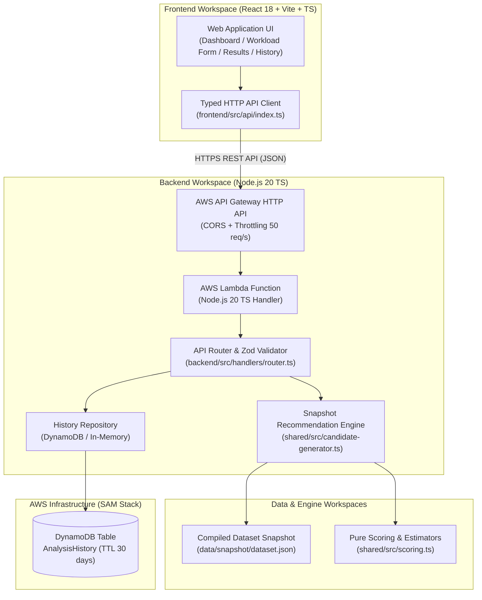
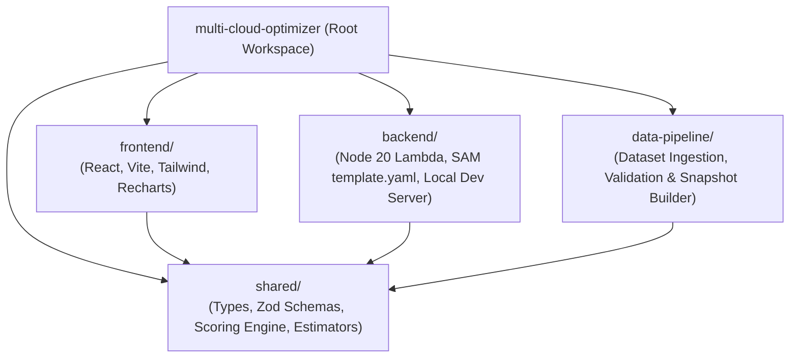
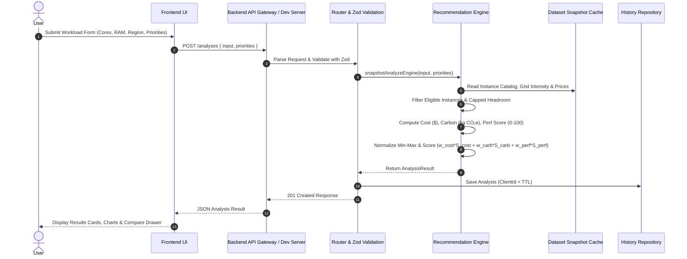
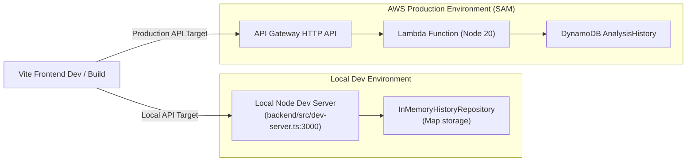

# System Architecture & Technical Design (`docs/ARCHITECTURE.md`)

**Version:** 1.1  
**Project:** Real-Time Multi-Cloud Carbon Footprint & Cost Optimizer  
**Stack:** React + Vite + TypeScript + Tailwind CSS + Recharts (Frontend), Node.js 20 TS Lambda + API Gateway HTTP API + DynamoDB (Backend via AWS SAM).

---

## 1. System Overview

---

## 2. Monorepo Workspaces Layout

---

## 3. Data Processing & Recommendation Engine Flow

---

## 4. Local Execution & AWS SAM Deployment Architecture

---

## 5. Security, Infrastructure & Scalability Controls

1. **API Gateway Throttling:** Capped at 50 requests per second with a burst limit of 100 requests to prevent abuse.
2. **Lambda Execution Limits:** Memory set to 512 MB, timeout set to 10 seconds, concurrency cap set to 20 instances.
3. **Data Security & TTL:** Analysis history records are keyed per client ID (`X-Client-Id`) and automatically purged after 30 days using DynamoDB TTL.
4. **CORS & Headers:** Wildcard CORS enabled for HTTP API Gateway with preflight `OPTIONS` routing handled cleanly.
